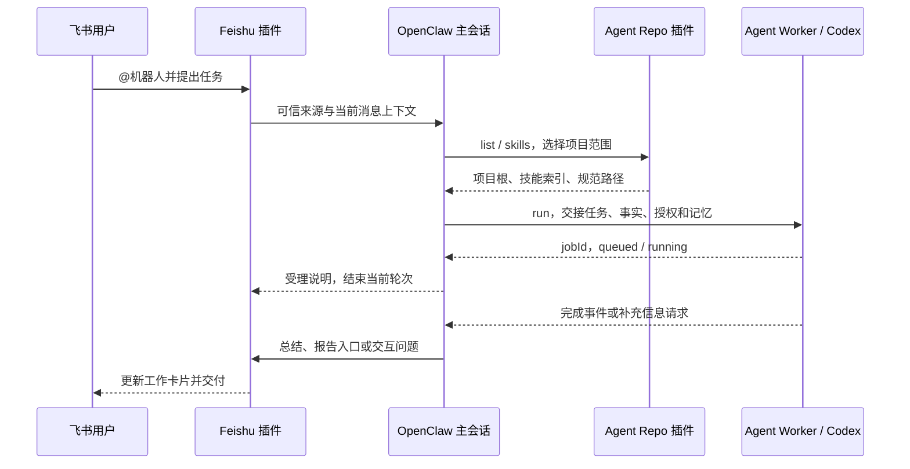

# agent-plugins

独立维护的 OpenClaw 插件工作区，包含飞书通道、Agent Repo 支持及本地 Codex 后台执行。飞书实现基于官方 v2026.9.5，并包含本仓库扩展；来源及许可证见 [UPSTREAM.md](UPSTREAM.md)。

主仓库：[Lydanne/agent-plugins](https://github.com/Lydanne/agent-plugins)。后续开发和安装以此仓库的 `main` 为准。

## 从哪里开始

| 你要做的事 | 阅读入口 |
| --- | --- |
| 安装插件，接入现有 OpenClaw | [OpenClaw 接入指南](docs/openclaw-setup.md) |
| 让飞书机器人接收消息、连续接话、展示卡片和报告 | [Feishu 使用与配置](packages/feishu/README.md) |
| 将角色、记忆和业务项目拆成独立仓库 | [Agent Repo 使用与配置](packages/agent-repo/README.md) |
| 将任务交给本地 Codex，查询进度、补充信息及收取结果 | [Agent Worker 使用与配置](packages/agent-worker/README.md) |
| 从模板创建自己的角色仓库 | [模板建仓指南](docs/agent-repo-template.md) · [GitHub 模板仓库](https://github.com/Lydanne/agent-repo-template) |
| 核对 Main/Worker 的记忆和项目交接合同 | [记忆与委派](docs/openclaw-memory-and-delegation.md) · [项目 API](docs/agent-repo-worker-project-api.md) |

## 三个插件如何协作

| 插件目录 | 插件 ID | 宿主中的配置 / 工具 | 职责 |
| --- | --- | --- | --- |
| `packages/feishu` | `feishu-conversation` | `channels.feishu`；`feishu_group_history` 等 | 飞书消息入口、上下文、工作卡片、交互提问及报告交付 |
| `packages/agent-repo` | `agent-repo` | `plugins.entries.agent-repo.config`；`agent_repo` | 将可信 Agent 绑定到角色仓库，校验项目、同步与技能范围 |
| `packages/agent-worker` | `agent-worker` | `plugins.entries.agent-worker.config`；`agent_worker` | 在管理员配置的本地 Codex 中执行任务，持久化任务与会话 |



图示采用 `asyncCompletion=true` 的飞书组合。Feishu 可独立使用；agent-repo 的 list/inspect 可独立使用；agent-worker 可关闭技能刷新后独立执行，完整飞书异步交付需要 Feishu 适配器。Agent Repo 是另一个角色仓库，模板仓库不是第四个插件。

## 开发与兼容范围

需要 Node.js 24.19+、pnpm 10.33.2。飞书 SDK、构建及类型检查以 OpenClaw 2026.9.5 为基线；其他宿主版本需独立验证，不能只按插件的最低 API 声明推断全面兼容。

```sh
pnpm install --frozen-lockfile --ignore-scripts
pnpm typecheck
pnpm build
(
  task_state_dir=$(mktemp -d "${TMPDIR:-/tmp}/openclaw-plugins-test.XXXXXX") || exit 1
  trap 'rm -rf -- "$task_state_dir"' EXIT
  export OPENCLAW_STATE_DIR="$task_state_dir"
  export OPENCLAW_CONFIG_PATH="$task_state_dir/openclaw.json"
  pnpm test
)
```

Feishu 编译为 `dist/` 并生成配置 schema；两个 ESM 插件进行语法检查，agent-worker 还构建控制 UI。测试运行各包配置的集合，保留的部分上游 Feishu 测试尚未适配；strict 类型检查覆盖生产 TypeScript 和 SDK 类型用例。通过本地检查不代表真实飞书租户、模型执行或生产部署已通过验证。

开发规则见 [AGENTS.md](AGENTS.md)；贡献者技能位于 `.agents/skills/`，Feishu 随包交付的业务技能位于 `packages/feishu/skills/`。本仓库在 main 上验证、提交和推送；生产配置及重启需单独授权。

[早期飞书开发与本机验证记录](docs/history/initial-feishu-development.md) 只用于追溯，不作为当前操作指南。
