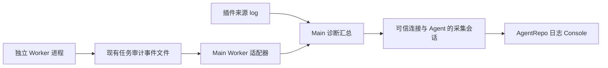

# 通用日志与实时调试

AgentRepo 的“日志”模块是 Main 的通用只读诊断界面。日志来自注册的插件来源，不自动读取 Gateway 全部日志，也不劫持浏览器 console。前端使用 MIT 许可的 `@tanstack/virtual-core@3.19.6` 渲染长列表；过滤、查找高亮、分类/来源/任务分组和对象树由本仓库实现。

## 插件日志接口

共享入口是 `@openclaw-plugins/agent-repo-api/diagnostics`。独立安装的 ESM 插件通过公共构建脚本获得 `dist/diagnostics-api.mjs`，避免依赖未发布的私有工作区包；TypeScript 插件可在构建中直接打包该工作区入口。

```js
import {registerDiagnosticSource} from './dist/diagnostics-api.mjs';
const source = registerDiagnosticSource({
  apiVersion: 1,
  id: 'my-plugin.operations',
  pluginId: 'my-plugin',
  label: '插件运行事件',
}, Symbol.for('my-plugin.diagnostics.owner'));

// context 来自宿主可信的 Agent/会话上下文，不能来自业务 payload。
source.log(context, () => ({
  level: 'info',
  eventName: 'operation.completed',
  category: 'operation',
  message: '处理完成',
  traceId,
  jobId,
  phase: 'main',
  data: {durationMs},
}));
// 在插件 service.stop 中释放；重新 start 时重新注册。
source.dispose();
```

返回值表示是否存在有效接收会话。无人订阅时返回 false，延迟函数不会执行。接口固定注入 Agent、插件、来源、事件 ID、观察时间；业务事件不能覆盖这些字段。注册属于可信插件代码能力，不是对不可信插件的安全沙箱。重复来源 ID 仅允许相同 owner 替换，替换会结束旧采集会话；旧 disposer 不会删除新注册。

事件可携带时间、级别、分类、事件名、任务、项目、traceId、阶段与结构化 data。接收时做快照与字段/常见凭证字符串脱敏，限制深度、节点数和单条大小，不求值 getter。插件仍须避免提交凭证和不必要的业务正文；自动脱敏不能替代调用方的数据筛选。

这是**实时内存日志接口**，不默认持久化。关闭后不补报关闭期间的日志。已有仓库异常历史与 Worker 任务审计继续按原规则留存。

## Main 汇总与 Worker 进程边界



Worker 不连接 Main 的内存注册表。agent-worker 在 Main 注册适配器；开启时记录现有文件末尾，之后按有界字节游标增量读取。任务必须通过 Agent、会话哈希、请求摘要与 jobId 核验。只读固定格式任务文件，不接受 UI 指定路径；拒绝软链接，处理跨批 UTF-8、部分行、轮换和截断。每轮先有界扫描文件元数据，仅核验并读取最多 16 个发生变化的事件文件，避免历史任务数量增加实时延迟；每文件最多 64 KiB；超出上报预算产生省略提示。目录最多 2000 个任务，超出时拒绝此次采集。

汇总包含 Worker 执行与已记录的 `main.*`、`worker.context_request` 协作事件，以 jobId 关联 traceId。不改变执行通路：Worker 调用 OpenClaw 插件仍请求 Main，由 Main 调用后返回。现有 Feishu CLI 直接执行权限不变。更细粒度调试点需补充审计事件或另行设计受采集会话控制的跨进程通道；本版不捕获全部 stdout/stderr。

## 生命周期与权限

- 打开页面只读取当前 Agent 的仓库历史和来源目录，实时调试默认关闭，不持久化开启状态。
- 手动开启需要 operator.write，随机会话 ID 绑定宿主 client.connId 与可信 Agent；缺失连接身份时拒绝启动。
- 公开 session action：projects-diagnosticSources、projects-diagnosticStart、projects-diagnosticRead、projects-diagnosticRenew、projects-diagnosticStop；采用有界游标轮询，不使用宿主私有广播。
- 每秒读取，每 5 秒续期；20 秒无续期则回收，服务端每秒清理到期会话。每连接最多 4 个，每个 Hub 最多 32 个。
- 关闭开关、离开模块、切换 Agent、失去呈现/权限、标签页隐藏、pagehide 或 signal 中止，会停止本页接收并请求释放；尚未取完的服务端日志分块同时失效。失败时提示等待超时；异步启动迟到后也立即 stop。
- 多页面会话独立。来源卸载、服务停止、读取失败或超时会关闭会话；重连后须手动开启。
- 每会话最多 2000 条或 5 MiB；事件最大 16 KiB，单次响应最多 20 条，沿用分块传输。captureId 与序号区分轮次，覆盖时返回 dropped/gap。前端另保留 2000 条并显示省略计数。
- 来源 open/read 各限 5 秒，并收到 AbortSignal。提供方须遵守中止、实现无阻塞 close；该机制无法抢占同步阻塞代码。

## Console 与验证边界

来源/级别/分类筛选、分组折叠、复制下载、清空视图与跟随最新在工具栏。查找支持高亮、前后定位及 Ctrl/Cmd+F，可展开匹配项分组；点击记录按需查看对象树和追踪字段。“清空视图”仅移除本页记录；“清空仓库记录”单独确认且需要写入权限，不删除 Worker 审计。日志按文本和对象渲染，不执行 JavaScript 或日志提供的 HTML。

选型核对于 2026-10-20：[TanStack Virtual](https://github.com/TanStack/virtual) 约 7150 star、近 90 天 59 次提交，10 月 16 日仍发布。Luna Console 已隔离试用，但对应目录最后修改于 2025-05，未作为生产依赖。升级应重新检查组件目录功能提交、发版频率、维护响应、许可证、体积和实测性能，不能仅凭 updated_at 或 star 判断。

测试覆盖默认关闭、连接/Agent 隔离、TTL、注册与释放、中断/迟到响应、缓冲游标、Worker 归属与增量读取及前端生命周期。浏览器预览使用模拟数据。构建与测试通过不等于真实 Gateway/Worker 上线验收；部署须另行执行，并核验宿主确实提供可信连接身份。
