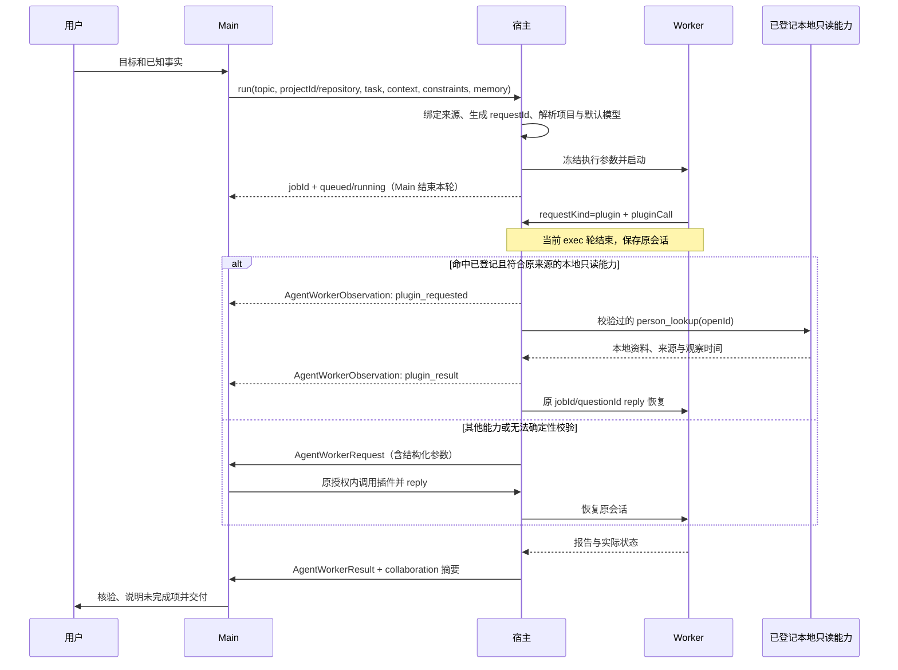
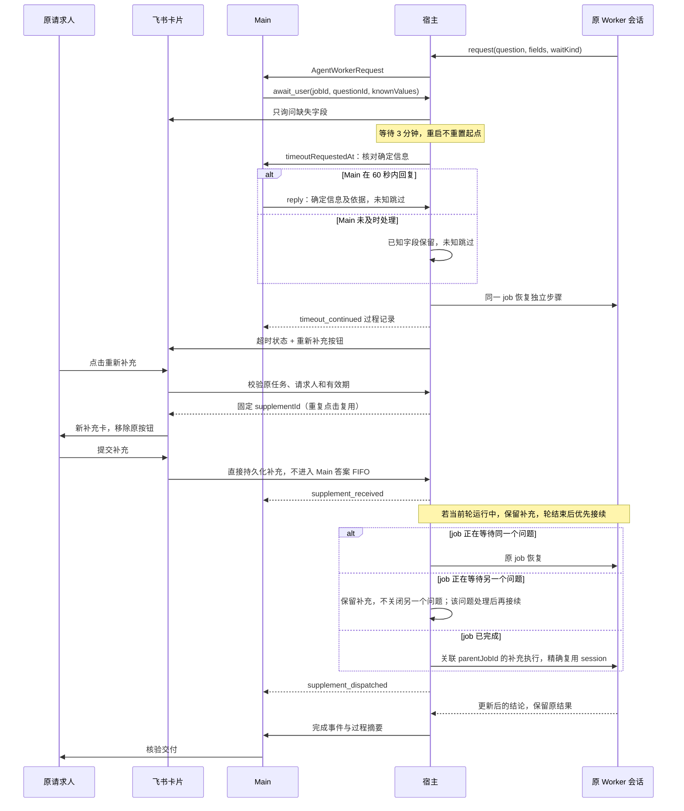

# Main 与 Worker 协作协议

本页描述当前实现；宿主与渠道都使用可信原任务绑定。Main 始终接收过程记录并核验最终结果。自然语言 constraints 与最终交付方式保持原合同。

## 正常执行与结构化插件协作



自动路径减少 Main 模型解释与 FIFO 等待；仍有 exec 暂停/恢复成本。未知能力、写入、认证及需要判断的操作继续由 Main 处理，不提供通用工具执行器。

## 超时继续与重新补充



运行能力边界：当前通过 `codex exec/resume --json -` 启动，初始输入写完后关闭 stdin，没有接入运行中 steer。这里的“直接”是绕过 Main 的答案处理队列；不承诺打断正在执行的工具。持久化补充在当前轮结束后优先续接，仍遵守全局容量、业务资源锁和同会话互斥。改为实时注入需要另行接入支持 steer 的传输。

真实回答优先于无输入超时；已提交但尚未处理的回答保留原文、字段及来源。问题最长有效期仍为 24 小时，首次提交仍检查问题期限；有效期内已受理的补充不会因排队或轮次等待过期，执行前继续核验原任务授权。取消、撤回、失联或会话绑定变化均不能借补充自动重跑。原 Worker 失败、超时、取消或缺少原会话时，保存 blocked/suppressed 及 reason，通过 supplement_unavailable 通知 Main，并将补充卡更新为“补充未执行”；通知失败可在后续扫描或重启后重试，不重跑业务。来源已撤回时不向失效来源发送通知。

## Main 的 run 参数

| 字段 | 责任与含义 | 例子 |
| --- | --- | --- |
| topic | Main 选择问题主题；已明确绑定时复用 | `notify-order-123` |
| projectId / repository | Main 选择登记项目；子仓库用 repository；两者同传必须一致 | `xgj` / `projects/xgj/repositories/server` |
| task | Main 描述本次目标和交付要求 | `核验订单通知是否发送，说明证据与缺口` |
| context | Main 交接必要事实、环境、标识、时间范围及来源 | `原消息订单号 ORDER-DEMO-123；生产；2026-10-20 至 2026-10-23 Asia/Shanghai` |
| constraints | Main 明确业务边界；仍为自然语言 | `只读该订单日志；不重发通知、不修改数据` |
| memory | 沿用现有配置要求，由 Main 提交真实检索结果；宿主不伪造检索 | `{status:"no_match",queries:["通知"],items:[]}` |
| responsibility | 可选，简述本次职责 | `核对调用链和发送回执` |
| requestId | 可省略，宿主按可信来源版本、topic 和项目选择器生成；显式值保留旧合同 | 明确重新执行：`order-123-rerun-2` |
| modelId / thinkingLevel | 有明确覆盖需求时传；否则宿主应用默认配置 | `thinkingLevel: 3`，不意味着自动换模型 |
| resourceKeys | 写操作明确提供稳定对象键；恢复和补充自动继承 | `["production:order:ORDER-DEMO-123"]` |

来源身份、消息版本、账号、时间戳、jobId/questionId、项目解析和执行配置校验归宿主负责。不能由模型伪造。topic 的业务判断仍在 Main；不同正文不能通过自动 requestId 当成无声重试。跨消息核对旧任务使用 jobId，明确跨消息重试须保留原 requestId。

资源锁优化限于可信范围的继承与校验。本次没有增加结构化业务目标（第 4 项），所以不能从自然语言 task/constraints 自动推导任意业务对象锁；首次涉及同一对象的写入仍须明确 resourceKeys。

## Worker 协作请求参数

```json
{
  "type": "request",
  "requestKind": "plugin",
  "question": "请读取原请求人的本地账号映射",
  "reason": "本任务需核验请求人映射",
  "progress": "已确定目标记录，尚未执行写入",
  "pluginCall": {
    "callId": "requester-lookup-1",
    "capability": "person_lookup",
    "arguments": {"openId": "ou_demo_requester"},
    "purpose": "核对原任务人员资料"
  }
}
```

| 字段 | 含义和约束 |
| --- | --- |
| type | 固定 `request`；宿主分配 questionId，Worker 不指定正式问题 ID |
| requestKind | `context` 信息补充，默认值；`plugin` 插件协作，分别计数 |
| question / reason / progress | 所需内容、必要性和已完成工作；都必须提供 |
| pluginCall.callId | 当前 job 内稳定调用标识，最长 100 字符；同一次调用重试不换 ID，同 ID 不允许改变调用内容 |
| pluginCall.capability | 已登记能力名；本次自动支持 `person_lookup` |
| pluginCall.arguments | 能力参数对象，序列化不超过 4000 字符；person_lookup 仅接受 openId |
| pluginCall.purpose | 用途说明，最长 1000 字符；不作为授权依据 |
| waitKind | `optional`、`required`（省略按此处理）、`decision`、`authorization`；影响缺失处理说明，不提供任意超时设置 |
| fields | 可选表单字段，最多 6 项；示例 `{id:"date",label:"日期",type:"date",timezone:"Asia/Shanghai",required:true}` |
| allowFreeText | 是否接受自由文本；false 时必须提供 fields |
| recommendation | 仅供 Main 参考，不代表用户选择 |

person_lookup 只接受原可信请求人或原生提及者的 OpenID；Agent、账号和应用由宿主绑定。结果包含 `ok/source/found/person/observedAt`。found=false 是本地未命中，不代表飞书不存在此人；不会自动联网或写人员库。未登记能力、对象不在绑定范围、身份不足或服务不可用时回到 Main。结果缓存只对同 job/callId/参数有效，重复执行需求使用新 callId 并保留原任务授权。

| waitKind | 超时后行为 |
| --- | --- |
| optional | 缺失注明，继续其余步骤 |
| required | 未知参数对应步骤跳过，交付已核验结果与未完成项 |
| decision | 未明确的选项不代选，继续不依赖决策的工作 |
| authorization | 未确认成功的授权不当作成功，跳过依赖授权的操作 |

## 宿主与卡片内部字段

| 字段 | 含义和例子 |
| --- | --- |
| jobId / questionId | 原执行和问题的宿主标识，reply/await_user 使用这组绑定 |
| knownValues | Main 已确认的字段；例如 `{date:"2026-10-23"}`，只隐藏这些字段的输入框 |
| answer / answerBasis | 回复正文及可选来源依据；例如“日期已从原消息核实” |
| timeoutRequestedAt | 宿主开始等待 Main 核对的时间戳；不重置 3 分钟起点 |
| resumeReason | `user_wait_timeout` 标明超时续接，与真实答案来源分别保存 |
| supplementId / supplementOf | 新补充记录 ID，以及原 questionId；回调只携带绑定 ID，服务端读取真实任务 |
| parentJobId | 原 job 已完成后补充执行关联的原 job；不覆盖旧报告 |
| continuationPriority | 宿主内部优先级，先处理已接纳补充，不能绕过资源锁 |
| collaboration.events | Main 最终事件的过程摘要：kind、时间、callId、questionId、supplementId、childJobId（按事件适用） |

恢复边界：飞书先保存真实回答及宿主时间，再交接 Worker。首次提交必须在期限内；已经保存的回答可在适配器恢复后跨越期限重试，重试只读取服务端原文、来源和时间，不接纳回调替换内容。旧表单与超时续接竞争时，迟到回答转入同一原问题的补充记录；已被超时流程采用的真实回答不再重复执行。旧卡片更新失败单独重试，不阻止已接纳补充接续。

已接纳任务恢复不受新任务等待队列上限阻挡，避免同会话后续任务排满队列后互相等待；实际执行仍受并发、会话和资源锁限制。补充恢复遇到原请求缺失、损坏或绑定不一致时，保存明确未执行原因并通知 Main，不重建业务授权。授权适配器暂缺时保留待处理状态；明确撤回时抑制执行和对失效来源的通知。

会话删除同时检查 Worker 补充记录和渠道已保存但未交接的回答；渠道状态无法核实、补充待执行或结果待通知时拒绝删除。已过期且未填写的补充，在渠道确认没有待交接回答后可随会话归档，避免永久占用；补充记录与协作通知记录一同归档。

过程记录先持久化并进入原 Main 系统事件队列，在后续 Main 轮次可见，不保证立即启动 Main。缺少 Main 过程记录适配器时，不悄悄执行自动插件调用。普通完成与补充完成始终走原 Main 核验交付路径。

## 验证边界

自动化测试使用临时状态、假的 Worker 进程及模拟飞书接口，覆盖超时类型、Main 核对窗口、重启续接、重复回调、发送不确定、来源撤回、直接补充与自动插件调用的回退。部署、真实 OAuth、真实群卡片及生产 Worker 验收另行进行。
