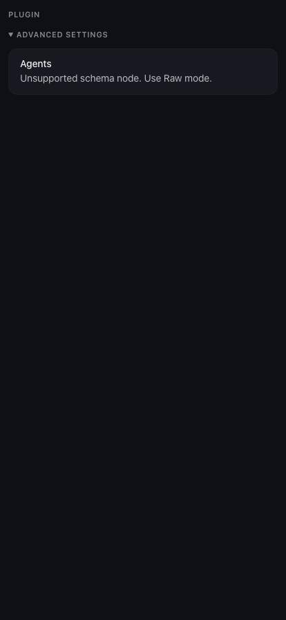
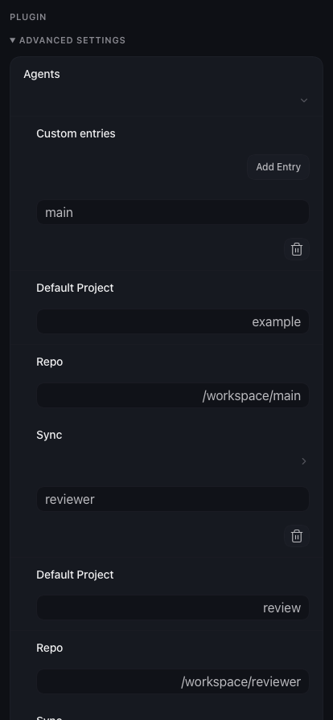

# OpenClaw 2026.10.5：无损编辑 Agent Repo 绑定

此目录是**宿主源码补丁与回归测试交付物**，不会被插件加载，也不会自动修改已安装的 OpenClaw、配置或 Gateway。正式控制面板需在另行部署修复后的同版本宿主之后才会改变。

## 问题与修复

OpenClaw 的现有表单支持动态对象键，但分析器未接受 `minProperties`、`maxProperties` 和字符串的 `not.pattern`，导致完整 Agent Repo schema 出现 8 个不支持路径，最外层 `agents` 整块不可编辑。

补丁只补齐宿主对这些既有校验能力的识别，不改插件 schema、不删除校验、不固定 Agent ID，也不改保存协议。复用现有字段控件及完整 schema 校验，因此这份 schema 无需新增 JSON 编辑器；其他尚不支持的结构继续保留原始模式回退。没有给任意 `not` 结构放行。

同时加强已有无效配置的渐进修复路径：新增或恶化对象数量违规会被拒绝，仍可逐步修复已有违规，包含 `allOf` 中的限制。

## 精确基线与许可

- 上游：<https://github.com/openclaw/openclaw>
- 标签：`v2026.10.5`
- 源码提交：`1b58cb9a1b4f4353e1add63c8506db4d890962e8`
- 上游许可保存在 `LICENSE.openclaw`。
- 测试 schema 是本仓库 `packages/agent-repo/openclaw.plugin.json` 的完整 `configSchema` 快照；测试配置完全虚构，无真实账号、凭证或业务数据。
- 补丁包含生产源码、完整 schema fixture、浏览器及实际客户端保存路径的回归测试。
- 补丁 SHA-256：`0a9588b697cdd56599b39ce754a56f25eb5f91e8c19ff7bcb611976d5f83de6a`。

## 应用与验证

只在上述提交的独立、干净源码 checkout 上操作。设置 `PATCH` 为本目录 `config-form.patch` 的绝对路径，并核对 `git rev-parse HEAD`。不要对安装目录或其他版本强行套用。

```sh
git apply --check "$PATCH"
git apply "$PATCH"
pnpm install --frozen-lockfile --ignore-scripts --filter openclaw-control-ui... --filter @openclaw/markdown-core...
pnpm exec playwright install chromium
pnpm tsgo:ui
pnpm exec vitest run --config ui/vitest.config.ts \
  ui/src/components/config-form-agent-bindings.browser.test.ts \
  ui/src/components/config-form.constraints.test.ts \
  ui/src/components/config-form-map-integrity.browser.test.ts \
  ui/src/components/config-form-composition-integrity.browser.test.ts \
  ui/src/components/config-form-scalar-integrity.browser.test.ts \
  ui/src/lib/config/config-agent-bindings-save.test.ts \
  ui/src/lib/config/config-write-coordinator.test.ts \
  ui/src/lib/config/config-draft-model.test.ts --maxWorkers=1
pnpm ui:build
```

使用源码声明的 pnpm 版本；本次为 Node 24.22.0、pnpm 12.9.0。浏览器测试使用 Playwright 固定 Chromium，避免本机浏览器语言影响既有英文断言。浏览器回归会生成 `ui/src/components/agent-bindings-form.png`，这是测试产物，无需提交到宿主源码。

回退源码前先检查是否有后续改动；仅在反向预检通过时执行：

```sh
git apply --reverse --check "$PATCH"
git apply --reverse "$PATCH"
```

## 本次证据（2026-10-21）

- 原始分析器：新增回归测试失败，复现“不支持的架构节点”；修复后完整 schema 不再有不支持路径。
- 8 个测试文件、176 项测试通过；测试运行墙钟约 1.96 秒，未运行远端 CI。
- `pnpm tsgo:ui` 和 `pnpm tsgo:test:ui`（含所有 UI 测试分片）通过。
- `pnpm ui:build` 返回 0；存在既有启动包体积提示：原始版本 374175 B、修改版本 374184 B，提示门槛 373454 B。未放宽门槛或改动性能基线。
- 无操作保存与只修改 `main.repo` 都保留其他 Agent、可选字段、嵌套同步设置及未展示字段。测试检查实际客户端 `config.set` 序列化的整份 payload 和版本哈希。
- 非法路径、动态键名、控制字符、缺少必填项、额外不允许字段、对象数量约束仍被拒绝。
- 独立审查指出的已有无效对象数量约束问题已修复并复核。
- 补丁在精确上游 HEAD 的独立索引上通过正向应用预检，修改树通过反向回退预检。
- 交付仓库 `agent-plugins` 的 `pnpm typecheck`、`pnpm build`、隔离状态下 `pnpm test` 全部通过。

保存测试使用隔离的 mock Gateway，证明真实客户端编辑和提交链路，不代表正式 Gateway 已写盘验收。没有试写正式配置、重启服务或部署宿主。

## 隔离浏览器前后截图

截图使用同一合成配置，包含 `main` 与 `reviewer` 两个 Agent。

| 修复前 | 修复后 |
| --- | --- |
|  |  |
